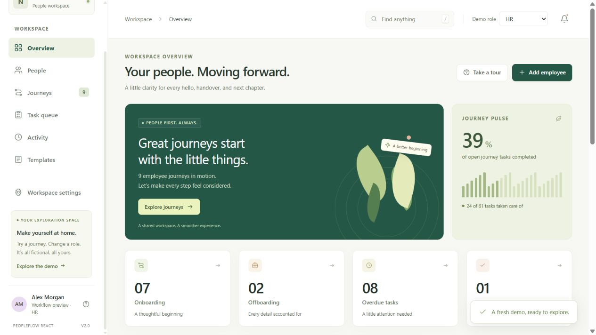

# PeopleFlow React

A React frontend portfolio application for employee onboarding and offboarding at the fictional **Northstar Studio**. HR, IT, and managers coordinate connected tasks, equipment, notes, and employee journeys.

The screens, forms, navigation, and shared application state use React. Workflow rules live in framework-independent JavaScript so they can be tested separately from the interface.

**[Open the live demo](https://sonakshisharma1508.github.io/peopleflow-react/)** · [Demo walkthrough](docs/DEMO-GUIDE.md) · [Code and React guide](docs/REACT-GUIDE.md)



The demo uses fictional records stored in your browser. The HR, IT, and Manager selector previews task ownership; it is not a login system.

## Start here

1. Download the project or clone it:

```sh
git clone https://github.com/SonakshiSharma1508/peopleflow-react.git
cd peopleflow-react
```

2. Open a terminal in the folder containing `package.json`.
3. Run:

```sh
npm ci
npm run dev
```

Open the address printed by Vite, normally `http://127.0.0.1:5173/`. Keep the terminal running; `Ctrl+C` stops it. Node.js **22.12 or newer** is required; Node.js **24 is recommended**. npm is included with Node.js.

No API key, environment file, database, or account is needed. Use the development server rather than double-clicking `index.html`.

**For learning, follow one document:** [React guide](docs/REACT-GUIDE.md). It explains the files, React concepts, and click-to-state flow. The previous vanilla JavaScript handbook describes version 1; use this guide for the React implementation.

## What is implemented

| Area               | Working behavior                                                                                          |
| ------------------ | --------------------------------------------------------------------------------------------------------- |
| Overview           | Counts, open-journey task progress, overdue attention items, and recent activity.                         |
| People             | Search, combined department/status filters, sorting, eight-row pagination, and full-directory CSV export. |
| Journeys           | Open onboarding/exit cards, type and health filters, and profile navigation.                              |
| Employee profile   | Connected checklist, progress, coordination notes, activity, and assigned equipment.                      |
| Task queue         | Cross-employee search, owner/status filters, and current demo-role shortcut.                              |
| Forms              | Controlled React forms for employee creation/review, equipment assignment, and starting an exit.          |
| Workflow rules     | Task ownership, prerequisites, safe reopening order, assignment/return gates, and HR journey closure.     |
| Search and dialogs | Workspace search, guided tour, overdue-task list, and deliberate reset confirmation.                      |
| Templates          | Read-only built-in onboarding and offboarding task definitions.                                           |
| Persistence        | Versioned, validated browser storage with visible recovery and conflict warnings.                         |
| Exports            | Directory CSV and current-session JSON downloads; JSON import is not implemented.                         |

## What React is doing

- Page and reusable UI components render JSX.
- Props carry data into tables, rows, badges, progress bars, and other shared pieces.
- `useState` controls form fields, selected tabs, dialogs, and other local interface choices.
- Context exposes the current session and actions through the custom `usePeopleFlow` hook.
- A pure reducer applies prepared session updates. Domain commands generate IDs/timestamps before dispatching those updates.
- Effects synchronize browser listeners, focus, document title, and cleanup.
- React Router's `HashRouter` supplies routes such as `#/people/EMP-1045`. Query parameters hold relevant filters.

Ordinary user-entered strings render as JSX text. The application does not use legacy HTML-string views or `dangerouslySetInnerHTML` for the interface.

## Stack

**React, React DOM, JavaScript/JSX, HTML, plain CSS, React Router, Vite, Node.js/npm, browser localStorage, Prettier, Vitest, React Testing Library, jsdom, and Node's built-in test runner.**

React interaction tests also use Testing Library's user-event helpers and jest-dom matchers. There is no TypeScript, Redux, CSS framework, application backend, real authentication, or shared database in this release. Installing test helpers does not add a backend to the application.

## Commands

| Command                | Purpose                                             |
| ---------------------- | --------------------------------------------------- |
| `npm run dev`          | Start the local development server.                 |
| `npm run test:domain`  | Run the preserved workflow/storage tests with Node. |
| `npm run test:react`   | Run the React tests once with Vitest.               |
| `npm run test:watch`   | Keep the React test runner watching changes.        |
| `npm test`             | Run both test groups.                               |
| `npm run build`        | Generate the production application in `dist/`.     |
| `npm run preview`      | Serve the production build locally for inspection.  |
| `npm run check`        | Run the tests and production build.                 |
| `npm run format:check` | Check source formatting with Prettier.              |
| `npm run format`       | Apply Prettier formatting.                          |

Use the current test output as the authority for results and counts. Node rule tests, simulated-DOM interaction tests, and real-browser review provide different evidence; none alone certifies accessibility or production security. This release has no ESLint configuration or lint script.

## Try the sample stories

Use [the demo walkthrough](docs/DEMO-GUIDE.md) for exact steps. A fresh sample has:

- **Omar Hassan, EMP-1045:** onboarding starts unfinished; document verification unlocks the IT account task.
- **Maya Chen, EMP-1021:** exit confirmation and handover are complete, but the laptop must still be returned.
- **Noah Wilson, EMP-1041:** the checklist is complete and HR can finish onboarding immediately.

Fresh sample dates are relative to creation day. Saved dates remain fixed. **Workspace settings → Reset demo** replaces current React-demo changes after confirmation. Export a snapshot first if you want a copy for inspection; it cannot be imported back automatically.

## Publish through GitHub Pages

1. Create a repository with `main` as its default branch.
2. Put the contents of this project at the repository root, including `package.json`, `package-lock.json`, and `.github/workflows/pages.yml`. Do not upload `node_modules/` or local secrets.
3. In **Settings → Pages → Build and deployment**, select **GitHub Actions** as the source.
4. Push the project. If Pages was enabled after the first workflow ran, rerun **Verify and deploy PeopleFlow React** or trigger it manually.
5. Inspect the successful deployment URL and perform a smoke review before sharing it.

The workflow installs locked dependencies, runs tests, builds, and deploys updates from `main`. Pull requests verify without deploying. The relative asset base and hash routes support repository-subpath hosting. Check [Actions](https://github.com/SonakshiSharma1508/peopleflow-react/actions) for the latest deployment result.

After changing files in a local clone, publish the update with:

```sh
git add .
git commit -m "Describe your change"
git push origin main
```

GitHub Pages updates automatically after the checks pass. Do not commit real employee records, credentials, `node_modules/`, or generated `dist/` files.

## Demo boundaries

- **Fictional data only:** no real employee records should be entered.
- **Local data:** React uses the storage key `peopleflow.react.v2`, separate from the original version's key. It does not automatically import version 1 data.
- **Role preview:** the visitor selects HR, IT, or Manager. This illustrates workflow ownership; it is not sign-in or trusted authorization.
- **Recorded work:** task completion does not create/revoke actual work accounts, inspect documents, process payroll, or send notifications.
- **Recovery:** an unreadable saved snapshot is retained while temporary sample edits are allowed without saving. Another-tab warnings also pause this tab's later saves. There is no transactional concurrency or automatic conflict merge.
- **Limited history:** activity keeps at most 250 local events. Starting offboarding replaces the current checklist rather than retaining independent historical journey objects.
- **No PWA yet:** this is a responsive, statically hostable website; install/offline synchronization is later work.

For the implementation changes and future React/backend boundaries, read [Migration notes](docs/MIGRATION.md).
